<div align="center">
  

# Markaqui

**Agendamento de consultas para clínica médica.** A paciente vê os horários livres, agenda em quatro toques e acompanha ou cancela pelo celular. A clínica administra médicos, agenda e consultas num painel.

App Expo (React Native) · API Node/Express · SQLite · login com papéis · teste de carga com hipóteses

</div>

<p align="center">
  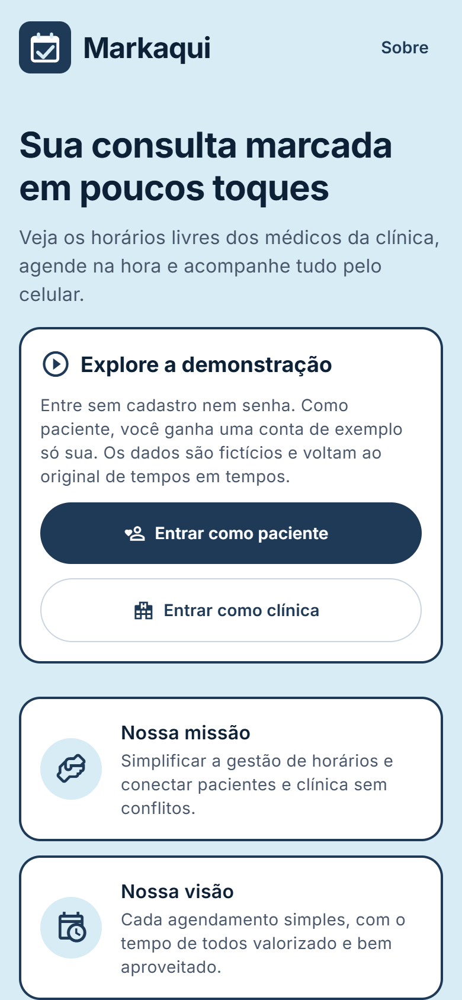
  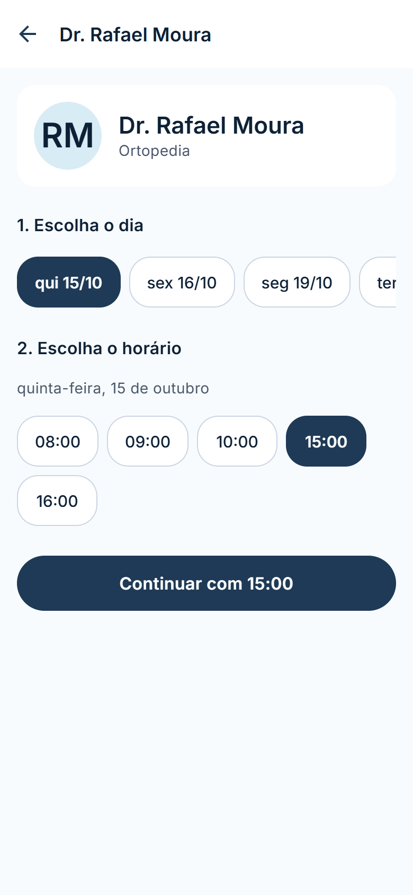
  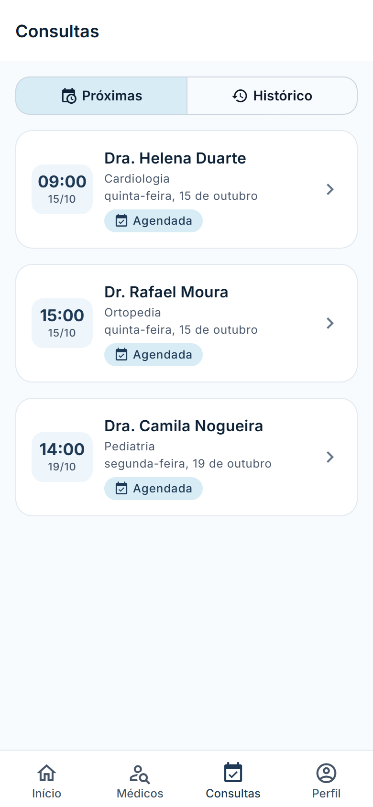
  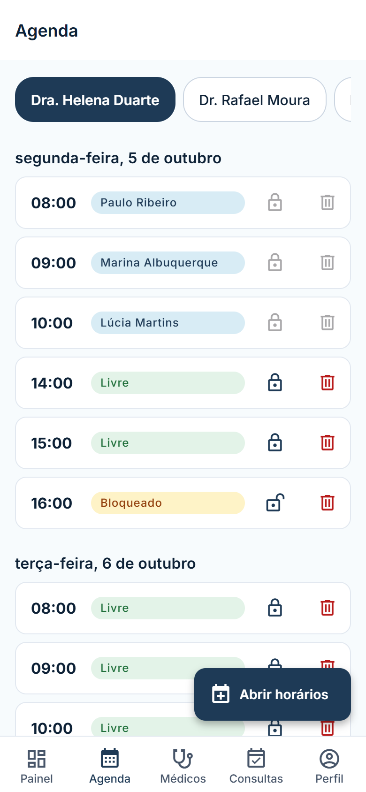
</p>

## O que tem aqui

| Para a paciente | Para a clínica (gestor) |
|---|---|
| Criar conta, entrar, trocar senha | Painel com consultas de hoje e da semana |
| Ver médicos por especialidade | Cadastrar, editar e remover médicos |
| Agendar: médico, dia, hora, confirmar | Abrir vários horários de uma vez, bloquear e desbloquear |
| Próximas consultas e histórico | Ver todas as consultas e cancelar |
| Cancelar até o horário da consulta | Conta criada só pela administração (sem autocadastro) |

Também: boas-vindas e escolha de perfil, recuperar senha (honesta: explica o caminho, porque o app não envia e-mail), termos, página "Sobre / como foi feito", 404, erro global, estado "sem conexão com o servidor", carregando, vazio e erro em toda lista, avisos em Snackbar e confirmação própria para ações destrutivas.

<details>
<summary><b>Mais telas</b></summary>
<p>
  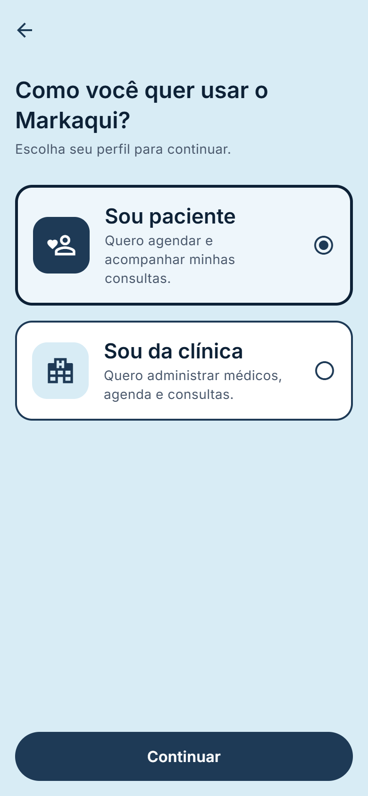
  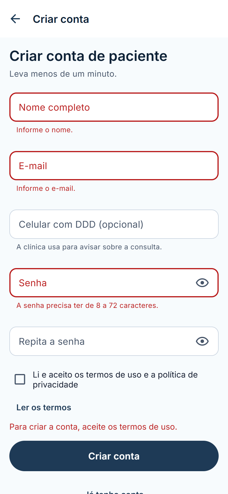
  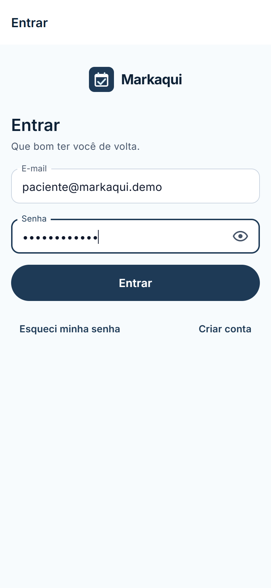
  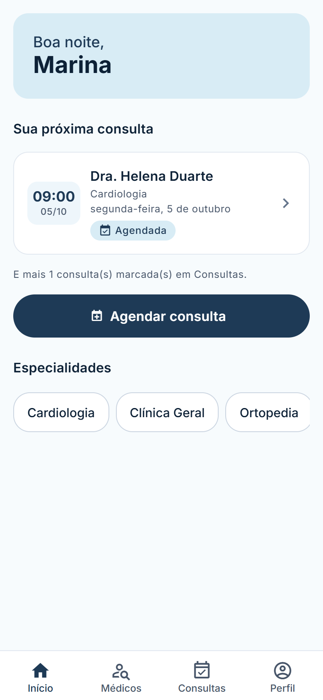
  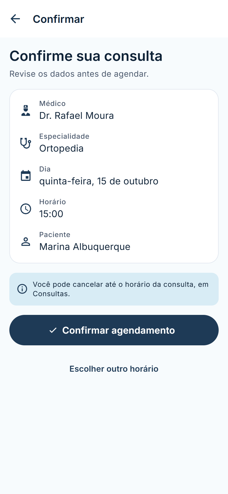
  
  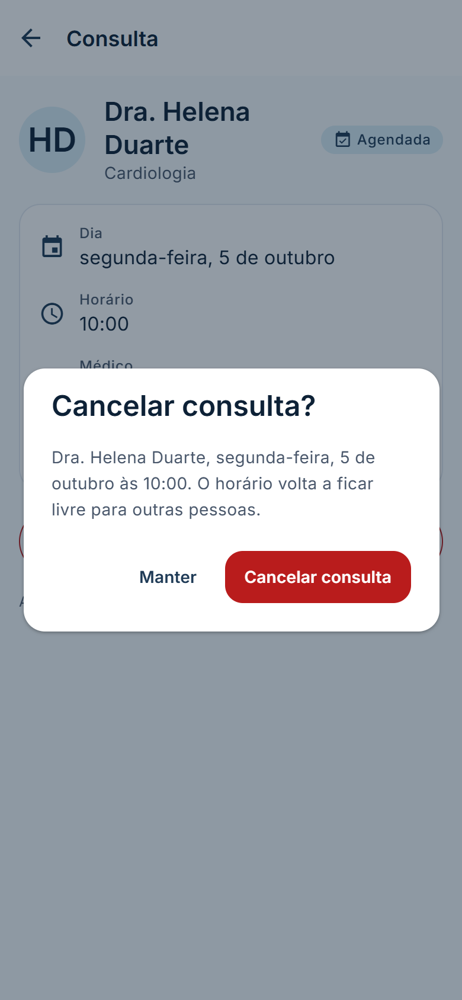
  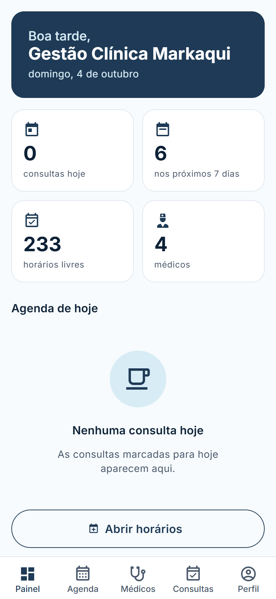
  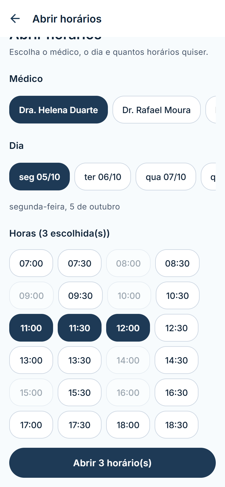
  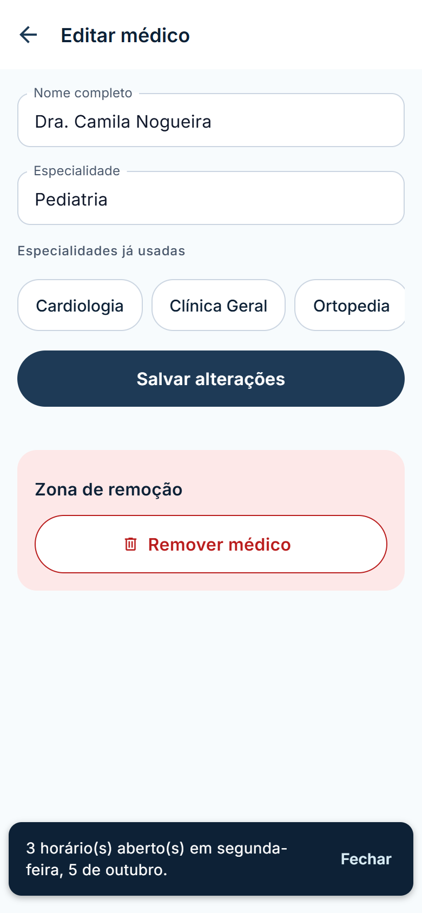
  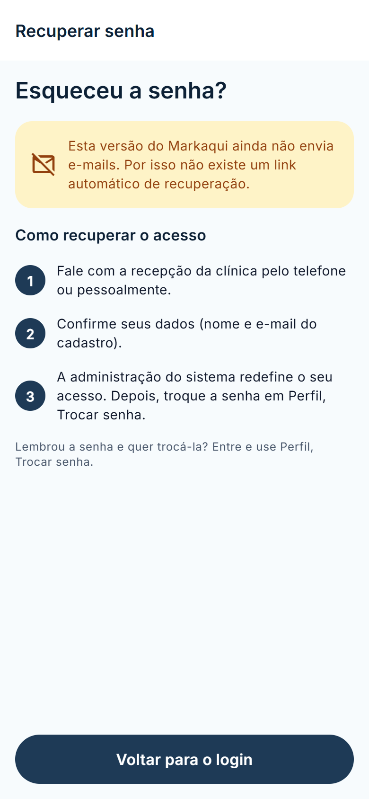
  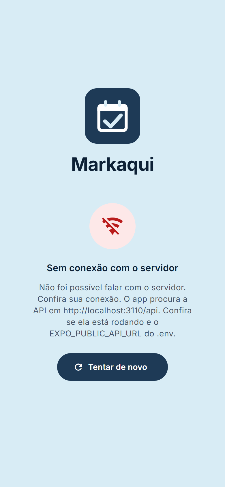
</p>
<p>Prints reais tirados do app rodando no navegador (Expo web) com os dados de demonstração.</p>
</details>

## Arquitetura

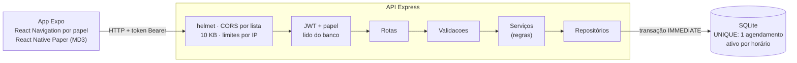

Detalhes: [Arquitetura da Solução](docs/05-Arquitetura%20da%20Solução.md) (camadas, segurança, modelo de dados) e [guia do código](src/Markaki/README.md) (estrutura, variáveis, rotas da API).

## Rodar em poucos minutos

Pré-requisito: [Node.js](https://nodejs.org/) 20 ou mais novo.

**Windows:** dois cliques em `iniciar.bat`. Ele cria os arquivos `.env` (com um segredo de login aleatório), semeia o banco com médicos e horários de demonstração e abre a API e o Expo. Na janela do Expo, tecle `w` para abrir no navegador, `a` para o emulador Android, ou leia o QR code com o Expo Go (celular na mesma rede Wi-Fi).

**Qualquer sistema:** veja os passos em [src/Markaki/README.md](src/Markaki/README.md#rodar).

Contas de demonstração criadas pelo `iniciar.bat`:

| Papel | E-mail | Senha |
|---|---|---|
| Paciente | `paciente@markaqui.demo` | `Paciente2026` |
| Clínica | `gestor@markaqui.demo` | `Gestor2026` |

Essas senhas são só para a demonstração local. Rodando `npm run semear` sem elas no `.env`, o script gera senhas aleatórias e as mostra no console.

## Testes

```bash
npm test --prefix src/Markaki/backend   # 65 testes da API, banco SQLite temporário
npm test --prefix src/Markaki           # 40 testes do app (cliente HTTP, validação, agenda, contraste)
```

Cobrem login e sessão (401, sessão expirada, senha trocada), papéis (403), limites (413, 429), regras da agenda, concorrência (10 pacientes no mesmo horário: um só entra), cancelamento lógico e contraste de cores WCAG AA. Plano completo em [docs/08](docs/08-Plano%20de%20Testes%20de%20Software.md).

## Teste de carga

Antes de trocar o armazenamento, as hipóteses foram escritas e a API foi medida com o arquivo JSON da primeira versão; depois, medida de novo com SQLite, com o mesmo roteiro (autocannon, banco descartável numa pasta temporária, gerador e servidor na mesma máquina). Resultados, gráfico e quais hipóteses se confirmaram: [docs/carga](docs/carga/2026-10-04-resultados.md).

## Decisões

- **Clínica médica, não B2B genérico.** A proposta acadêmica (abaixo) era agendamento para prestadoras de serviço; o código sempre foi de clínica, então a versão 2.0 assume esse domínio. A situação de cada requisito está em [docs/02](docs/02-Especificação%20do%20Projeto.md#situação-na-versão-20-outubro-de-2026).
- **SQLite no lugar do arquivo JSON:** transações e índices UNIQUE em vez de uma fila global que relia e regravava o arquivo inteiro a cada escrita. Medido antes e depois.
- **Segurança por padrão:** gestor só por script, papel lido do banco, paciente vê só os próprios dados, senha com bcrypt, limite de tentativas, API em `127.0.0.1` a menos que se peça a rede.
- **Cancelamento lógico:** a consulta cancelada fica no histórico, com data e quem cancelou.
- **Identidade do próprio projeto:** marinho, azul-gelo e Inter, tirados dos protótipos da equipe ([docs/06](docs/06-Template%20Padrão%20da%20Aplicação.md)). O mascote dos protótipos saiu por ser parecido com um personagem de terceiros; fotos externas deram lugar a avatares com iniciais.

## Limitações

- Não envia e-mail nem notificação push: recuperar senha depende da administração.
- Uma clínica e um processo de API (SQLite local); para escalar, PostgreSQL com o mesmo desenho de repositórios.
- No navegador, o token fica no `localStorage` (no celular, no armazenamento seguro do sistema).
- Sem login com Google, sem encaixe nem lista de espera, sem relatórios de receita.

## Próximos passos

Notificações (lembrete 24 h antes), redefinição de senha pela clínica, testes de componentes das telas (React Native Testing Library), HTTPS e deploy, várias unidades.

## Projeto acadêmico

`Análise e Desenvolvimento de Sistemas` · `Projeto: Desenvolvimento de uma Aplicação Móvel em um Ambiente de Negócio` · `Terceiro Semestre` (PUC Minas)

Proposta original: um aplicativo de agendamento B2B para empresas prestadoras de serviço, com gestão de várias agendas, notificações push e painel para decisões. A versão 2.0 manteve a ideia central (agenda por profissional, autonomia de quem agenda, painel para quem administra) aplicada a uma clínica.

Integrantes: Jefferson Luiz Mendonça da Silva, Levi Alves de Oliveira Neto, Bruno Pereira Figueiredo, Kauã Eduardo Silva, William Leal Rocha Viana e Welder Fernandes de Morais. Orientador: Will Ricardo dos Santos Machado.

Versão 2.0 (portfólio, outubro de 2026): mantida por Jefferson Luiz, autor do protótipo das telas institucionais.

### Documentação

1. [Documentação de Contexto](docs/01-Documentação%20de%20Contexto.md)
2. [Especificação do Projeto](docs/02-Especificação%20do%20Projeto.md) (com a situação dos requisitos na 2.0)
3. [Metodologia](docs/03-Metodologia.md)
4. [Projeto de Interface](docs/04-Projeto%20de%20Interface.md)
5. [Arquitetura da Solução](docs/05-Arquitetura%20da%20Solução.md)
6. [Template Padrão da Aplicação](docs/06-Template%20Padrão%20da%20Aplicação.md)
7. [Programação de Funcionalidades](docs/07-Programação%20de%20Funcionalidades.md)
8. [Plano de Testes de Software](docs/08-Plano%20de%20Testes%20de%20Software.md)
9. [Registro de Testes de Software](docs/09-Registro%20de%20Testes%20de%20Software.md)
10. [Plano de Testes de Usabilidade](docs/10-Plano%20de%20Testes%20de%20Usabilidade.md)
11. [Registro de Testes de Usabilidade](docs/11-Registro%20de%20Testes%20de%20Usabilidade.md)
12. [Apresentação do Projeto](docs/12-Apresentação%20do%20Projeto.md)
13. [Referências](docs/13-Referências.md)

Protótipos da equipe (fora do app): [prototipos/](prototipos/README.md) · Apresentação: [presentation/](presentation/README.md)
