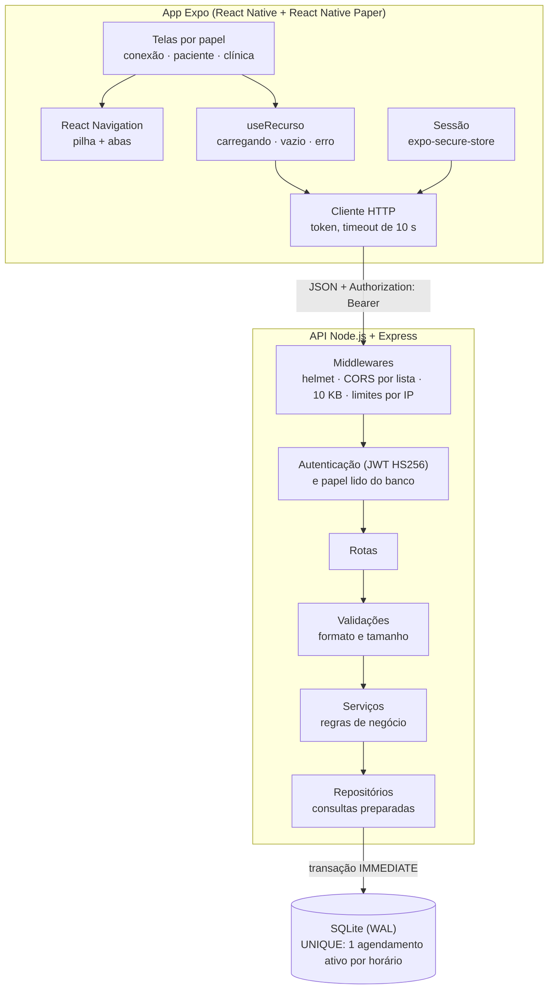
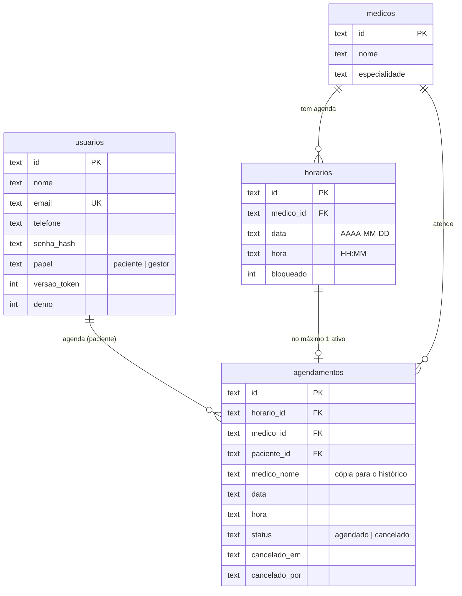

# Arquitetura da Solução

Pré-requisitos: <a href="04-Projeto de Interface.md"> Projeto de Interface</a>

Arquitetura real da versão 2.0 (outubro de 2026). O código está em [`src/Markaki`](../src/Markaki/README.md).

## Visão geral

### Camadas da API

| Camada | Pasta | Responsabilidade |
|---|---|---|
| Entrada | `backend/server.js`, `src/config.js` | Lê o ambiente (sem `JWT_SECRET` forte a API não sobe), abre o banco e escuta em `HOST:PORT`. |
| Aplicação | `src/app.js` | Monta helmet, CORS, limitadores, `express.json({ limit: '10kb' })`, rotas e o 404 em JSON. |
| Middlewares | `src/middlewares/` | Autenticação por token, exigência de papel e conversão de erros em respostas (`{ erro }`). |
| Rotas | `src/routes/` | Só HTTP: chama a validação, abre leitura ou escrita no armazenamento e devolve o status. |
| Validações | `src/validators/` | Tipo, formato (data AAAA-MM-DD, hora HH:MM, e-mail, telefone) e tamanho, antes de abrir a transação. |
| Serviços | `src/services/` | Regras: agenda por médico, nada no passado, um agendamento por horário, até 3 consultas ativas por paciente, cancelamento lógico, quem vê o quê. |
| Repositórios | `src/infra/sqlite/` | SQL preparado, esquema e migrações. O estado do horário (livre, bloqueado, agendado) é calculado na consulta. |

Cada escrita roda numa transação `IMMEDIATE` do better-sqlite3: verificar ("o horário está livre?") e gravar acontecem juntos, e um erro no meio desfaz tudo. Os índices UNIQUE parciais são a última linha de defesa contra agendamento duplicado.

### Segurança

- Senhas com bcrypt (custo 10); login responde igual para e-mail inexistente e senha errada e sempre calcula um hash.
- Token JWT HS256 com validade de 8 h; o papel usado na autorização vem do banco a cada requisição; trocar a senha invalida os tokens anteriores.
- Autocadastro cria só paciente. Gestor real existe apenas pelo script `npm run criar-gestor`.
- Modo demonstração (`DEMO_ENABLED`, desligado por padrão): `POST /api/demo/entrar` devolve uma sessão sem senha, de uma paciente efêmera por visita (com teto e limpeza no reset) ou do gestor de demonstração; contas protegidas contra troca de senha e perfil ([ADR 0004](adr/0004-modo-demonstracao.md)).
- Atrás do proxy da hospedagem, `TRUST_PROXY=1` faz o limite de tentativas valer por visitante.
- Paciente vê só as próprias consultas e só horários livres e futuros, sem nome de outras pessoas; consulta de outra paciente responde 404.
- Limites: 5 tentativas de login, cadastro ou troca de senha por minuto por IP, 300 requisições por minuto por IP, corpo de até 10 KB, até 3 consultas futuras ativas por paciente.
- A API escuta em `127.0.0.1` por padrão; `HOST=0.0.0.0` só para testar no celular na mesma rede.
- No celular o token fica no armazenamento seguro do sistema; no navegador (Expo web) fica no `localStorage`.
- Não há uma tela "sem permissão" separada: cada papel só monta as próprias telas (não existe caminho para a área do outro). Se a API responder 403, o estado de erro da tela mostra "Sem permissão".

## Modelo de dados

O esquema físico está em [`backend/src/infra/sqlite/esquema.js`](../src/Markaki/backend/src/infra/sqlite/esquema.js). Nome do médico e da paciente, data e hora ficam copiados no agendamento: o histórico continua legível se o horário ou o médico forem removidos. Renomear o médico atualiza só as consultas ativas.

### Por que SQLite (e não mais o arquivo JSON)

A primeira versão gravava tudo num `database.json` relido e regravado inteiro a cada requisição, com uma fila global para não perder escritas simultâneas. A troca por SQLite foi medida antes e depois com as mesmas hipóteses: ver [teste de carga](carga/2026-10-04-resultados.md).

## Tecnologias

| Parte | Tecnologia |
|---|---|
| App | Expo SDK 54, React Native 0.81, React 19, React Navigation 7 (native-stack e bottom-tabs), React Native Paper 5 (MD3), Inter (`@expo-google-fonts/inter`), react-native-svg, expo-secure-store |
| API | Node.js 24, Express 4, better-sqlite3, jsonwebtoken, bcryptjs, helmet, express-rate-limit, cors |
| Testes | `node:test`, supertest, banco temporário por arquivo de teste |
| Carga | autocannon (programático), `fetch` do Node para o teste de corretude |

## Hospedagem

Ver [Publicar a demonstração](deploy.md) e o [ADR 0005](adr/0005-hospedagem.md): API no Render (banco de demonstração efêmero recriado a cada partida e a cada 45 minutos) e app como Expo web na Vercel.

Localmente, `iniciar.bat` sobe tudo. O SQLite atende um único processo; para vários processos ou máquinas, o próximo passo é PostgreSQL com o mesmo desenho de repositórios.

## Qualidade de software

Características da ISO/IEC 25010 priorizadas e como são verificadas:

| Característica | Como o projeto atende | Métrica |
|---|---|---|
| Adequação funcional (correção) | Regras na camada de serviços, com testes para cada uma | 133 testes da API e 56 do app verdes; lint e formato no CI |
| Confiabilidade (tolerância a falhas) | Transações e índices UNIQUE; estados de erro e "sem conexão" no app | 0 agendamento duplicado sob carga (S2) |
| Segurança (confidencialidade, autenticidade) | Hash, token, papéis, limites | Testes 401/403/429 e revisão de segurança |
| Eficiência de desempenho | SQLite com índices | req/s e p97,5 no teste de carga |
| Usabilidade (acessibilidade) | Rótulos, alvos de 48 dp, contraste AA testado | `src/tema/contraste.test.mjs` |
| Manutenibilidade (modularidade) | Camadas separadas, tokens de tema num lugar só | Revisão de código |
