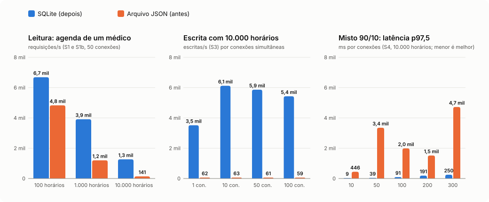

# Teste de carga da API do Markaqui

Objetivo: medir a API antes e depois da troca do armazenamento (arquivo JSON com fila global de escrita para SQLite com transações) e verificar a regra de negócio mais importante sob concorrência: **um horário nunca recebe dois agendamentos ativos**. Hipóteses escritas em 04/10/2026, antes de qualquer medição; medições finais em 13, 14 e 15/10/2026 (a linha de base JSON foi medida de novo em 15/10, ver abaixo).

## Hipóteses (escritas antes de medir)

| # | Cenário | Hipótese (JSON, antes) | Hipótese (SQLite, depois) |
|---|---|---|---|
| S1 | `GET /api/horarios?medico_id=` com 100 horários, 50 conexões | >= 1.500 req/s, p97,5 < 50 ms | igual ou melhor (consulta com índice) |
| S1b | o mesmo com 1.000 e 10.000 horários | a vazão cai quase linearmente com o tamanho do arquivo, porque cada GET relê e faz o parse do JSON inteiro; com 10.000 horários, < 150 req/s e p97,5 > 300 ms | a vazão quase não depende do total de horários (índice por médico): com 10.000, >= 5x a vazão do JSON |
| S2 | 200 horários livres, 20 `POST /api/agendamentos` simultâneos por horário (4.000 pedidos) | 0 agendamento duplicado (a fila global serializa); exatamente 200 respostas 201 | 0 duplicado, garantido também pelo índice UNIQUE parcial |
| S3 | escrita (alternar disponibilidade) com 1, 10, 50 e 100 conexões | a vazão de escrita não sobe com a concorrência (fila global); teto entre 150 e 400 escritas/s com 100 horários e < 30/s com 10.000; a latência cresce com a fila (lei de Little) | teto bem mais alto (escrita de uma linha, não do arquivo todo); com 10.000 horários, >= 10x o JSON |
| S4 | misto 90% leitura / 10% escrita, degraus de 10 a 300 conexões | ponto de quebra (p97,5 > 2 s ou erros > 1%) antes de 300 conexões com 10.000 horários; a fila não tem limite, então a memória cresce | sem quebra até 300 conexões |
| S5 | 50 leitores e 50 escritores ao mesmo tempo (Windows) | possível `EPERM`/`EBUSY` no `rename` com leitura simultânea, gerando respostas 500; hipótese: > 0 erros | 0 erros (sem troca de arquivo) |
| S6 | `POST /api/auth/login` (só depois, com bcrypt custo 10) | não se aplica (não havia login) | entre 5 e 30 logins/s por núcleo; o limitador devolve 429 a partir da 6ª tentativa por minuto |
| S7 | `POST /api/medicos` com corpo de 90 KB | aceito (limite padrão de 100 KB, sem limite por campo); o arquivo cresce cerca de 90 KB por pedido e degrada S1 | recusado com 413 (limite de 10 KB) e 400 por campo longo |

## Protocolo

- Ambiente descartável: pasta temporária do sistema com arquivo de dados próprio (`DATA_FILE` no JSON, `DB_FILE` no SQLite), API em `127.0.0.1` na porta 3101, nunca um banco do repositório.
- A API roda num processo separado (`carga/servidor.js`), que informa CPU (em % de um núcleo) e pico de memória (RSS) pelo IPC.
- Gerador: `autocannon` 8 (programático) e, no S2, `fetch` do Node com 200 pedidos em voo.
- Aquecimento de 3 s antes de cada cenário de vazão. Latência em p50, p97,5 e p99 (o autocannon não calcula p95; no S2 o p95 é calculado pelo script).
- Máquina: Ryzen 5 5600 (6 núcleos, 12 threads), 16 GB, Windows 11, Node 24.11.1. **Gerador e servidor dividem a mesma máquina**: os números servem para comparar versões, não como capacidade absoluta.
- Trava `.carga-lock` na raiz da oficina, com caminho absoluto (o roteiro recusa caminho relativo): só uma carga por vez na máquina. A partir das rodadas Antes e Depois, o resumo grava a janela exata da medição (`medicaoInicio` e `medicaoFim`) e o nome da trava usada (`trava`, só o nome, sem o caminho da máquina).

Como reproduzir, na pasta `src/Markaki/backend`:

```
# Antes: API com arquivo JSON (commit 27c2754), com a pasta carga/ atual copiada para dentro
npm run carga -- --armazenamento json --trava "<caminho absoluto>/.carga-lock" --saida <arquivo.json>
# Depois: a mesma API com SQLite (commit 3c2b2b1); Final: a versão atual
npm run carga -- --armazenamento sqlite --trava ... --saida ...
npm run carga -- --armazenamento final --trava ... --saida ...
# Gráfico
node carga/grafico.js <antes.json> <depois.json> ../../../docs/carga/2026-10-15-grafico.svg
```

## Três versões medidas

| Versão | Commit | Janela da medição (horário de Brasília) | Resumo |
|---|---|---|---|
| **Antes**: arquivo JSON e fila global | `27c2754` | 15/10/2026, 04:53:50 a 04:57:54 | [`dados/2026-10-15-json.json`](dados/2026-10-15-json.json) |
| **Depois**: SQLite, mesma API (sem login) | `3c2b2b1` | 14/10/2026, 00:14:32 a 00:18:47 | [`dados/2026-10-13-sqlite.json`](dados/2026-10-13-sqlite.json) |
| **Final**: SQLite com login, papéis, validações, helmet e limites | `341ea71` | 13/10/2026, fim às 23:37 (início aproximado, 23:13) | [`dados/2026-10-13-final.json`](dados/2026-10-13-final.json) |

A comparação do armazenamento é **Antes x Depois**: a mesma API, só o repositório muda. A versão **Final** mostra quanto custa a segurança (token conferido e usuário lido do banco a cada requisição, validações e limites).

Rodadas descartadas:

- a de 04/10 (outras cargas na máquina e um erro do roteiro que mandava o S6 e o S7 para a raiz da API);
- a do JSON de 13/10 (21:34 a 22:01), que cruzou com a carga do Cineclube, cujo roteiro não respeitava a trava (janelas dele: 04/10 18:26 a 18:47 e 13/10 21:39 a 22:06);
- **a do JSON de 14/10 (20:55:51 a 21:00:13), descartada por contaminação.** Ela segurou a trava, mas, como se soube depois, o GestaoPro rodou `npm ci` (painel, app e testes de carga) e `dotnet publish` de 20:54 até cerca de 21:04, ou seja, durante toda a rodada, e o GymFlow rodou build e testes .NET de 20:53 a 20:56. Com a CPU disputada, a linha de base saiu baixa e **exagerava a melhora** do SQLite. O resumo fica guardado em [`dados/descartadas/2026-10-14-json-contaminada.json`](dados/descartadas/2026-10-14-json-contaminada.json) só como registro.

A linha de base foi medida de novo em 15/10, das 04:53:50 às 04:57:54, com o roteiro novo segurando a trava compartilhada. Antes de começar, um roteiro esperou até ter, em duas leituras seguidas: a trava livre, nenhum k6, npm, npx, next ou roteiro de carga rodando, nenhum dotnet, MSBuild, VBCSCompiler ou mongod usando CPU e a CPU total abaixo de 15%. Durante a rodada, amostras a cada 15 s só mostraram os processos do próprio roteiro. Com a máquina livre, o JSON ficou de 23% a 931% mais rápido que na rodada contaminada (a maior diferença está nas escritas concorrentes com 100 horários), então as razões ficaram menores que as publicadas antes: na leitura com 10.000 horários, o SQLite faz 9,0 vezes a vazão do JSON (antes, 13,6); nas escritas com 10.000 horários, de 57 a 97 vezes (antes, cerca de 140). As conclusões não mudam: todas as hipóteses de vantagem do SQLite se confirmam com folga.

O que cada resumo comprova:

- **Antes** (15/10) e **Depois** (14/10): o arquivo traz `medicaoInicio`, `medicaoFim` e `trava`, ou seja, a janela exata e a prova de que a rodada segurou a trava. A Antes rodou com a máquina conferida livre (acima). A Depois pode ter tido uma sobreposição curta com um processo do GymFlow no começo (ver Limitações).
- **Final**: rodou antes de o roteiro gravar esses campos. O arquivo só traz o fim (`data`, 23:37 de Brasília); o início (por volta de 23:13) vem do registro da sessão, e **o arquivo não comprova que a trava foi usada**. A janela termina mais de uma hora depois da última carga conhecida do Cineclube (até 22:06), então não há sobreposição conhecida, mas os números da Final pesam menos que os de Antes e Depois. Ela serve para mostrar a ordem de grandeza do custo da segurança, não como medição de referência.

## Resultados



Cada célula: requisições por segundo / latência p97,5 em ms / falhas (respostas 5xx, erros de conexão e timeouts).

| Cenário | Variante | Antes (JSON) | Depois (SQLite) | Final (SQLite e login) |
|---|---|---|---|---|
| S1 | 100 horários, 50 conexões | 4.829 / 13 / 0 | 6.685 / 11 / 0 | 3.997 / 13 / 0 |
| S1b | 1.000 horários, 50 conexões | 1.200 / 51 / 0 | 3.912 / 23 / 0 | 3.045 / 18 / 0 |
| S1b | 10.000 horários, 50 conexões | 141 / 389 / 0 | 1.266 / 48 / 0 | 910 / 60 / 0 |
| S3 | 100 horários, 1 conexão | 491 / 2 / 0 | 3.962 / 0 / 0 | 2.705 / 0 / 0 |
| S3 | 100 horários, 10 conexões | 471 / 38 / 0 | 6.122 / 2 / 0 | 3.710 / 3 / 0 |
| S3 | 100 horários, 50 conexões | 557 / 148 / 0 | 5.396 / 12 / 0 | 3.544 / 16 / 0 |
| S3 | 100 horários, 100 conexões | 549 / 235 / 0 | 5.606 / 20 / 0 | 3.710 / 29 / 0 |
| S3 | 10.000 horários, 1 conexão | 62 / 22 / 0 | 3.514 / 0 / 0 | 2.614 / 0 / 0 |
| S3 | 10.000 horários, 10 conexões | 63 / 184 / 0 | 6.120 / 2 / 0 | 3.466 / 3 / 0 |
| S3 | 10.000 horários, 50 conexões | 61 / 851 / 0 | 5.863 / 10 / 0 | 3.312 / 17 / 0 |
| S3 | 10.000 horários, 100 conexões | 59 / 2.082 / 0 | 5.426 / 21 / 0 | 3.260 / 35 / 0 |
| S4 | 10.000 horários, 10 conexões | 141 / 446 / **129** | 1.423 / 9 / 0 | 773 / 13 / 0 |
| S4 | 10.000 horários, 50 conexões | 139 / 3.350 / **92** | 1.439 / 39 / 0 | 794 / 71 / 0 |
| S4 | 10.000 horários, 100 conexões | 135 / 1.987 / **44** | 1.423 / 91 / 0 | 888 / 135 / 0 |
| S4 | 10.000 horários, 200 conexões | 140 / 1.517 / 0 | 1.230 / 191 / 0 | 855 / 265 / 0 |
| S4 | 10.000 horários, 300 conexões | 135 / 4.720 / **1.927** | 1.433 / 250 / 0 | 920 / 407 / 0 |
| S5 | 1.000 horários, 50 leitores | 1.178 / 53 / 0 | 2.677 / 22 / 0 | 1.342 / 38 / 0 |
| S5 | 1.000 horários, 50 escritores | 11 / 4.663 / **222 (99,6%)** | 2.673 / 22 / 0 | 1.340 / 38 / 0 |
| S7 | leitura antes dos corpos grandes | 1.197 / 50 / 0 | 5.295 / 11 / 0 | 3.014 / 19 / 0 |
| S7 | POST de 90 KB, 10 conexões | 27 / 907 / 0 (135 aceitos; arquivo com 12,1 MB) | 23 / 2.158 / 0 (116 aceitos; banco com 14,6 MB) | 3.783 / 4 / 0 (**18.912 recusados com 413**) |
| S7 | leitura depois dos corpos grandes | **34** / 1.809 / 0 | 4.867 / 12 / 0 | 3.040 / 18 / 0 |

S2, corretude sob concorrência (4.000 pedidos, 200 em voo, 20 por horário):

| Versão | Aceitos | Agendamentos ativos | **Duplicados** | Recusados | req/s | p50 / p95 / p99 (ms) |
|---|---|---|---|---|---|---|
| Antes (JSON) | 200 | 200 | **0** | 3.800 (400) | 1.085 | 158 / 358 / 508 |
| Depois (SQLite) | 200 | 200 | **0** | 3.800 (400) | 2.508 | 64 / 184 / 238 |
| Final | 200 | 200 | **0** | 3.800 (409, "acabou de ser reservado") | 2.685 | 65 / 116 / 181 |

S6, login com bcrypt custo 10 (só na versão final): 16 logins/s com 1 conexão (p50 de 57 ms), 16/s com 10 (p97,5 de 1.090 ms) e 15/s com 50 (p97,5 de 3.019 ms). Com o limitador padrão, os 8 logins seguidos responderam 429.

Memória da API (pico de RSS) no S4 com 300 conexões: 1.271 MB no JSON (pico de 1.315 MB com 200), 221 MB no SQLite e 225 MB na versão final.

## Hipóteses: confirmadas ou refutadas

| # | Resultado |
|---|---|
| S1 | **Confirmada.** JSON com 100 horários: 4.829 req/s e p97,5 de 13 ms. SQLite: 6.685 req/s. |
| S1b | **Confirmada.** Com 10.000 horários o JSON cai para 141 req/s e p97,5 de 389 ms (cada leitura faz o parse do arquivo inteiro), dentro do previsto (menos de 150 req/s e mais de 300 ms). Entre 100 e 1.000 horários a queda é menor que linear (o custo fixo da requisição pesa); entre 1.000 e 10.000, fica perto de linear. O SQLite fica em 1.266 req/s: **9,0 vezes** o JSON (hipótese: pelo menos 5). |
| S2 | **Confirmada nas três versões.** Exatamente 200 aceitos, **0 agendamento duplicado** e nenhum horário livre com agendamento ativo. No JSON quem garante é a fila global; no SQLite, a transação IMMEDIATE (o índice UNIQUE parcial é a última defesa e não precisou agir). |
| S3 | **Confirmada**, com os tetos do JSON refutados. A vazão de escrita do JSON não sobe com a concorrência (100 horários: 491, 471, 557 e 549 escritas/s) e a latência cresce com a fila (p97,5 de 2 ms até 235 ms; com 10.000 horários, de 22 ms até 2,1 s). Os tetos ficaram acima do previsto: de 471 a 557 escritas/s com 100 horários (previsto: 150 a 400) e de 59 a 63 com 10.000 (previsto: menos de 30). O SQLite escreve de 3.514 a 6.122 vezes por segundo: **de 57 a 97 vezes** o JSON com 10.000 horários (hipótese: 10). |
| S4 | **Confirmada.** O JSON quebra já com 10 conexões (9% de respostas 500, e p97,5 de 3,4 s com 50); com 300, são 1.927 erros de conexão e p97,5 de 4,7 s. A memória sobe de 372 MB para 1,3 GB (a fila não tem limite). O SQLite não quebra até 300 conexões: 1.433 req/s, p97,5 de 250 ms e nenhum erro. |
| S5 | **Confirmada.** No JSON, **99,6% das escritas** concorrentes com leituras falharam (222 de 223 respostas 500). Causa diagnosticada: `EPERM` no `fs.rename` do arquivo temporário sobre o `database.json` enquanto leitores o mantêm aberto (Windows); num teste isolado de 8 s, 119 de 124 escritas falharam com esse erro. No SQLite: nenhum erro e 2.673 escritas/s. |
| S6 | **Confirmada.** 15 a 16 logins/s, dentro da faixa prevista (5 a 30): o bcrypt é caro de propósito. O 429 apareceu, mas o próprio roteiro gasta as 5 tentativas do minuto ao entrar com as contas de carga, então os 8 pedidos deram 429. A sequência exata (5 respostas 401 e depois 429) é verificada no teste automatizado `auth.test.js`. |
| S7 | **Confirmada.** O JSON aceitou 135 corpos de 90 KB, o arquivo chegou a 12,1 MB e a leitura caiu de 1.197 para **34 req/s**. O SQLite sem limite (Depois) também aceitou, mas a leitura quase não mudou, porque a consulta pelo índice não depende do tamanho dos outros dados. A versão final recusa tudo com 413 e o banco fica com 0,2 MB. |

O custo da segurança na versão final é de 20% a 50% da vazão em relação ao SQLite sem login: cada requisição confere o token e lê o usuário no banco (o papel nunca vem do token). Ainda assim, a versão final supera o JSON em todos os cenários, menos um: a leitura com só 100 horários (S1), em que o arquivo JSON pequeno responde 4.829 req/s contra 3.997 da versão final. Com 1.000 horários ou mais, e em toda escrita, a versão final fica à frente.

## Limitações

- Gerador (autocannon, Node) e API dividem a mesma máquina e disputam CPU: os números comparam versões, não medem capacidade de produção. A API ficou perto de 100% de um núcleo (o Node atende numa thread só).
- Uma rodada por versão, sem repetição estatística: diferenças pequenas (menos de 15%) não devem ser lidas como melhoria.
- O S6 com o limitador padrão não mostrou a sequência 401 antes do 429 (ver acima).
- O teste isolado do S5 (8 s, sem carga externa) rodou fora da trava.
- **Linha de base remedida.** A rodada JSON de 14/10 foi descartada por contaminação (GestaoPro e GymFlow rodando builds durante ela, fora da trava) e substituída pela de 15/10, das 04:53:50 às 04:57:54, com a máquina conferida livre antes e durante a medição. Os números da tabela e do gráfico são os da rodada nova.
- **Sobreposição possível na rodada Depois (SQLite).** O GymFlow informou um `dotnet test` por volta de 00:14:20 de 14/10, fora da trava, que pode ter coincidido com o começo da rodada Depois (iniciada às 00:14:32). Efeito esperado: ruído no aquecimento e no primeiro cenário (S1), com o SQLite um pouco abaixo ali; isso só diminuiria a vantagem medida, nunca a aumentaria. Essa rodada não foi refeita.
- **Trava órfã.** A trava criada às 20:55:51 de 14/10, no começo da rodada JSON depois descartada, não foi removida, e a pasta ficou até 22:56, segurando as cargas do GestaoPro e do Cineclube por cerca de 2 horas. Causa provável, descoberta depois pelo Cineclube e reproduzida em teste aqui: no Windows, o `fs.rmSync` do Node 24 volta sem erro e **sem apagar** quando o caminho tem acento ("Projetos do portfólio"), então a liberação no `finally` não removia nada. Correção no roteiro (`carga/trava.js`): a pasta é apagada com `unlink` e `rmdir`, conferindo que sumiu; a trava agora guarda um `dono.json` (projeto, pid e início), é solta também em Ctrl+C (SIGINT), SIGTERM e SIGHUP (janela do console fechada), e quem encontra a trava ocupada vê o dono e se o processo dele ainda existe. Trava alheia nunca é apagada automaticamente. Um encerramento que não pode ser capturado (kill -9, "Finalizar tarefa") ainda deixa a pasta, mas agora com o dono identificado.
- O SQLite foi medido com um processo; o desenho não atende várias instâncias da API escrevendo no mesmo arquivo.
